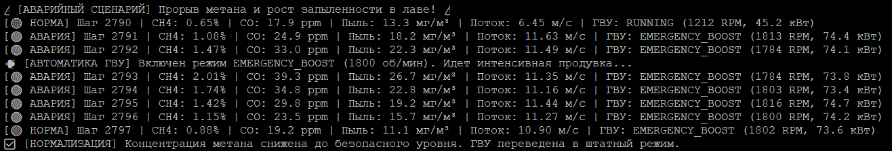
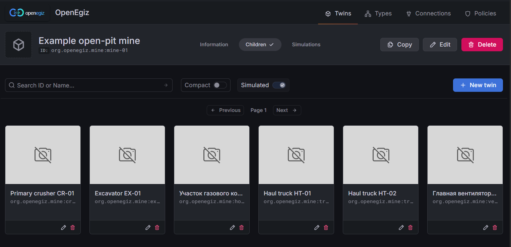
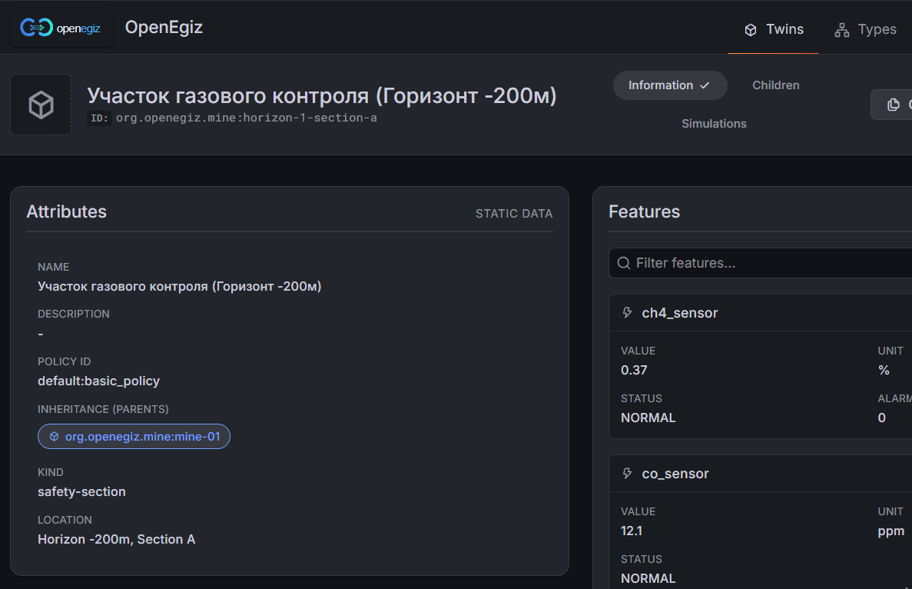
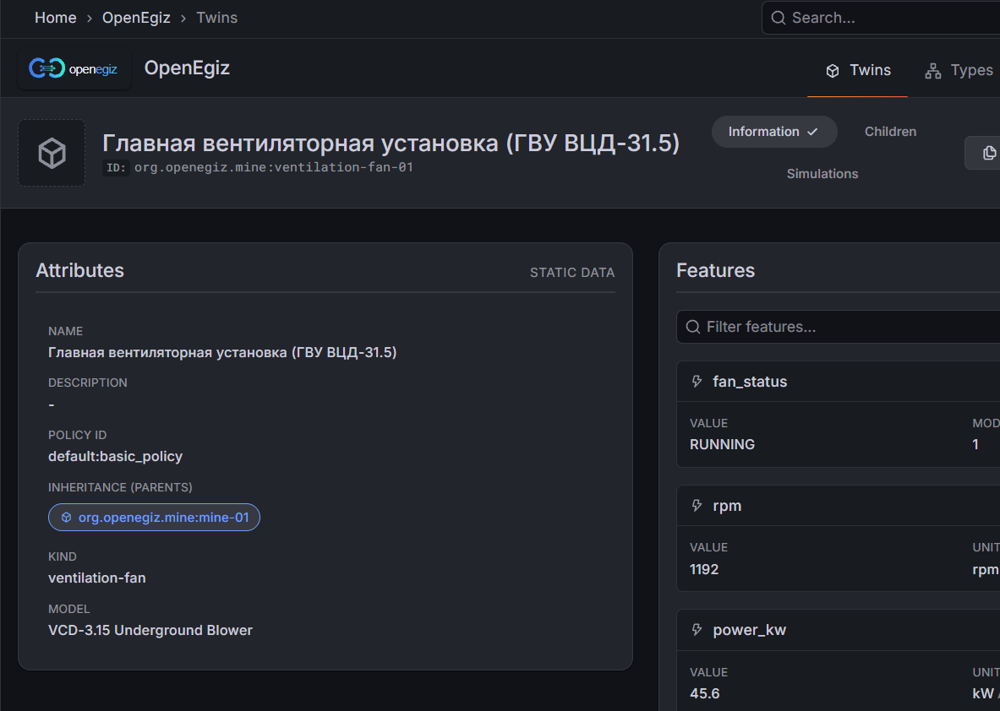
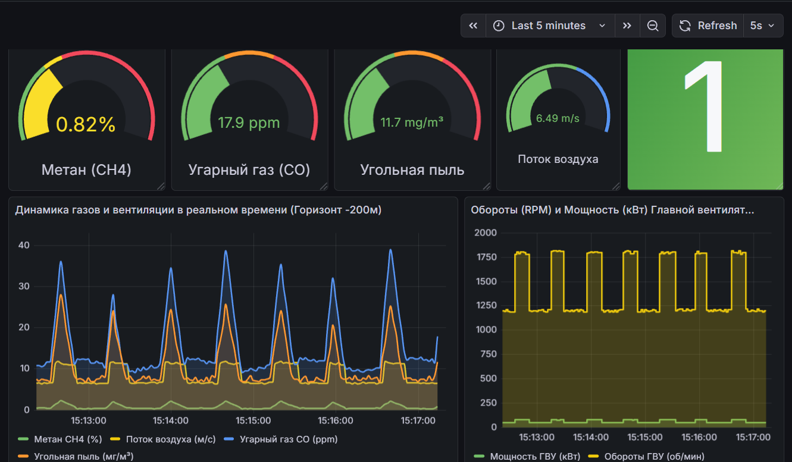

# SUBMISSION

## Concept

- **Enterprise:** Digital Mine / Industrial Safety Subsystem (Gas Control & Main Ventilation Unit)
- **Enterprise (KZ):** Цифрлық кеніш / Өнеркәсіптік қауіпсіздік ішкі жүйесі (Аэрогаздық бақылау және Бас желдеткіш қондырғысы)

- **Users:** Mine dispatchers, industrial safety engineers, ventilation automation operators
- **Users (KZ):** Шахта диспетчерлері, өнеркәсіптік қауіпсіздік инженерлері, желдетуді автоматтандыру операторлары

- **Decision:** Development of a fault-tolerant digital twin architecture based on Eclipse Ditto (`org.openegiz.mine:horizon-1-section-a` and `org.openegiz.mine:ventilation-fan-01`), integrated into the parent mine hierarchy (`org.openegiz.mine:mine-01`), with continuous telemetry streaming via MQTT (Mosquitto), persistence in InfluxDB via Telegraf, and real-time SCADA visualization in Grafana.
- **Decision (KZ):** Негізгі кеніш иерархиясына (`org.openegiz.mine:mine-01`) біріктірілген Eclipse Ditto (`org.openegiz.mine:horizon-1-section-a` және `org.openegiz.mine:ventilation-fan-01`) негізінде цифрлық егіздің ақауларға төзімді архитектурасын әзірлеу, MQTT (Mosquitto) арқылы телеметрияны үздіксіз жіберу, Telegraf арқылы InfluxDB-де сақтау және арнайы Grafana панелінде нақты уақыт режимінде визуализациялау.

- **Why this choice:** The MQTT + Eclipse Ditto + Telegraf + InfluxDB + Grafana stack is the golden standard of IIoT. It ensures instant automated response to methane ($CH_4$) surges (> 1.0%) by switching the main ventilation fan into emergency boost mode (`EMERGENCY_BOOST`).
- **Why this choice (KZ):** MQTT + Eclipse Ditto + Telegraf + InfluxDB + Grafana стэгі Өнеркәсіптік интернет заттарының (IIoT) алтын стандарты болып табылады. Ол метан ($CH_4$) концентрациясының қауіпті шектен (> 1.0%) асуына лезде реакция жасап, бас желдеткіш қондырғысын автоматты түрде апаттық форсаж режиміне (`EMERGENCY_BOOST`) ауыстыруды қамтамасыз етеді.

- **Real or fictional:** Real production case of underground mine aerogas safety and automated ventilation control.
- **Real or fictional (KZ):** Жер асты шахтасының аэрогаздық қауіпсіздігін және желдетуді автоматты басқаруды цифрландырудың нақты өндірістік жағдайы.

## Team

| Participant | GitHub Profile |
| :--- | :--- |
| Керімбекқызы Мунира (Team Lead) | [munikerim](https://github.com/munikerim) |
| Рахимов Нуркен Рашид Угли | [nurken-sys](https://github.com/nurken-sys) |
| Нуран Жандос | [Zhandos771](https://github.com/Zhandos771) |

## Mine

- **Monitoring object:** Gas Control Section Horizon -200m (`org.openegiz.mine:horizon-1-section-a`) & Main Ventilation Fan VCD-31.5 (`org.openegiz.mine:ventilation-fan-01`)
- **Monitoring object (KZ):** Бақылау облысы: Газды бақылау учаскесі Горизонт -200м (`org.openegiz.mine:horizon-1-section-a`) және Бас желдеткіш қондырғысы ГВУ ВЦД-31.5 (`org.openegiz.mine:ventilation-fan-01`)

## Modules and What-if Scenarios

| Module or What-if Scenario | What it does / Қызметі | How to see it on the Stand / Стендте қалай көруге болады | How to undo it / Қалай қайтаруға болады |
| :--- | :--- | :--- | :--- |
| **Telemetry & "What-if" Methane Surge Simulator (`my_simulator.py`)** | Generates real-time gas & dust metrics ($CH_4$, $CO$, dust, airflow) and simulates periodic methane outbursts (> 1.0%), triggering automatic ventilation boost (`EMERGENCY_BOOST` at 1800 RPM) until gas levels normalize.  *Нақты уақытта газ бен шаң деректерін жасайды және метанның апаттық таралуын (> 1.0%) модельдейді, газ деңгейі қалыпқа келгенше желдеткіштің автоматты форсажын (`EMERGENCY_BOOST`, 1800 айн/мин) іске қосады.* | Run script in terminal (`team/`): `python3 ~/team-007/team/my_simulator.py` | Stop script with `Ctrl + C`. |
| **Digital Twins (Eclipse Ditto)** | Registers child twins under `mine-01` with `default:basic_policy` and updates Feature properties dynamically via MQTT Ditto Protocol.  *`mine-01` ішінде еншілес егіздерді тіркейді және MQTT арқылы динамикалық қасиеттерді нақты уақытта жаңартады.* | Open **OpenEgiz -> Twins -> Example open-pit mine -> Children** tab. | Restart containers or delete via UI. |
| **SCADA Monitoring & Alarms (Grafana)** | Displays real-time Gauges, Stat status indicators, and Time Series charts for gas concentration and ventilation power/RPM.  *Газ концентрациясы мен желдеткіш қуаты/айналымы үшін шекті мәндердің түсті индикациясы бар графиктерді көрсетеді.* | Open `Мониторинг газовой безопасности и ГВУ (OpenEgiz)` dashboard in Grafana (`http://localhost:3000`). | Close tab or reset time filters. |

### Simulator in action / Симулятордың жұмысы:
*(Real-time generation of $CH_4$, $CO$, coal dust, airflow, and automated fan boost / Метан, улы газ, көмір шаңы, ауа ағыны және БЖҚ автоматты форсажын нақты уақытта генерациялау)*

## What works and what does not

- **Works:** Full end-to-end IIoT pipeline: automatic twin registration in Ditto, real-time MQTT telemetry streaming, Telegraf ingestion into InfluxDB, and interactive Grafana dashboarding with automated emergency ventilation scenarios.
- **Works (KZ):** Толық бапталған деректер алмасу циклі: Ditto-да егіздерді автоматты тіркеу, MQTT арқылы телеметрия ағыны, Telegraf арқылы InfluxDB-ге жазу және апаттық желдету сценарийлері бар интерактивті Grafana визуализациясы.

- **Does not:** No critical errors identified; all components operate stably.
- **Does not (KZ):** Критикалық қателер анықталмады, барлық компоненттер тұрақты жұмыс істейді.

## Data and Assumptions

- **Description:** Physical model of normal mine atmosphere ($CH_4 \approx 0.35\%$, $CO \approx 12\text{ ppm}$, dust $\approx 8.5\text{ mg/m}^3$, airflow $\approx 6.5\text{ m/s}$, fan at $1200\text{ RPM}$ / $45\text{ kW}$) and emergency outburst scenarios ($CH_4$ up to $2.25\%$, $CO$ up to $42\text{ ppm}$, triggering fan boost to $1800\text{ RPM}$ / $74.5\text{ kW}$ and airflow increase to $11.5\text{ m/s}$).
- **Description (KZ):** Шахта атмосферасының қалыпты режимінің ($CH_4 \approx 0.35\%$, $CO \approx 12\text{ ppm}$, шаң $\approx 8.5\text{ мг/м}^3$, ауа ағыны $\approx 6.5\text{ м/с}$, БЖҚ $1200\text{ айн/мин}$) және апаттық метан таралу сценарийінің ($CH_4$ $2.25\%$ дейін өскенде желдеткіштің $1800\text{ айн/мин}$ және ауа ағынының $11.5\text{ м/с}$ дейін күшеюі) физикалық моделі.

## Mine visualization

- **Description:** Implemented via interactive Grafana panels (Gauge, Stat & Time Series) with color-coded safety threshold indication.
- **Description (KZ):** Қауіпсіздік шектерінің түсті индикациясы бар интерактивті Grafana панельдері (Gauge, Stat және Time Series) арқылы жүзеге асырылды.

### Stand & Digital Twin Gallery / Стенд пен цифрлық егіз галереясы:

*List of digital twins inside `mine-01` (Children) / Цифрлық егіздер тізімі:*

*Gas control section attributes and features (`ch4_sensor`, `co_sensor`, `dust_sensor`, `airflow_sensor`) / Газды бақылау учаскесінің атрибуттары мен көрсеткіштері:*

*Main ventilation unit attributes and features (`fan_status`, `rpm`, `power_kw`) / Бас желдеткіш қондырғысының атрибуттары мен көрсеткіштері:*

*Real-time gas safety & ventilation monitoring dashboard in Grafana / Grafana-дағы нақты уақыттағы газ қауіпсіздігі және БЖҚ мониторинг панелі:*

## Limitations

- **Description:** Requires an active network environment inside the virtual machine for Docker containers.
- **Description (KZ):** Docker контейнерлері үшін виртуалды машина ішінде белсенді желілік ортаны қажет етеді.

## Presentation

- `presentation.pdf` is attached in the repository root. *(Репозиторий түбінде орналасқан).*

Platform: OpenEgiz v1.0.4.
